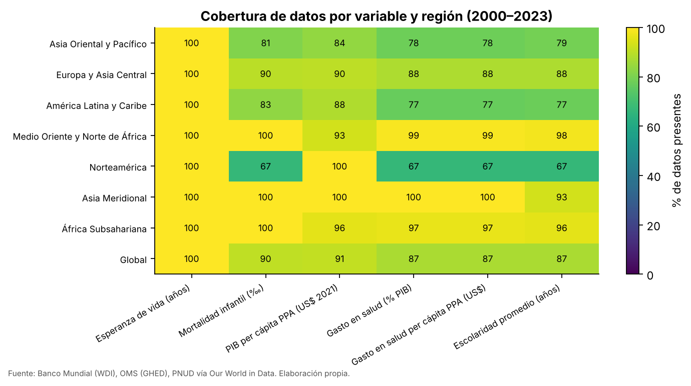
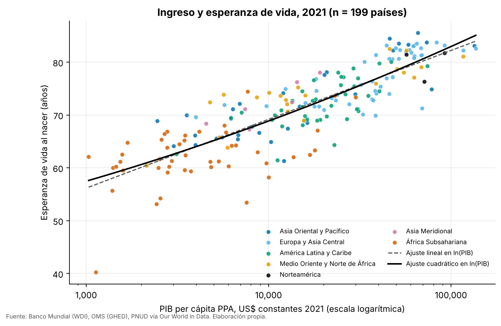
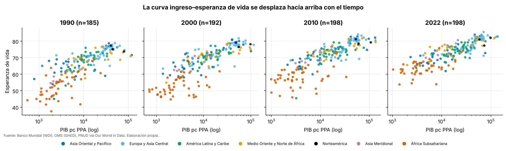
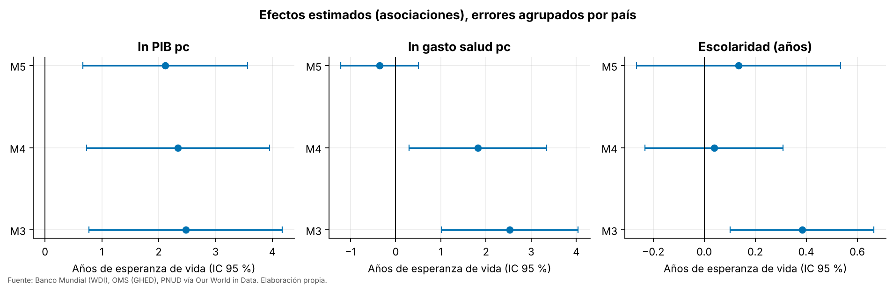
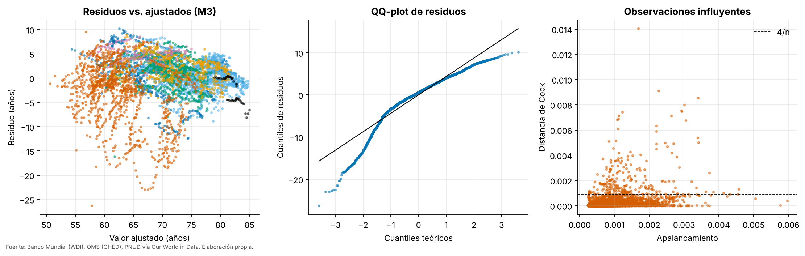
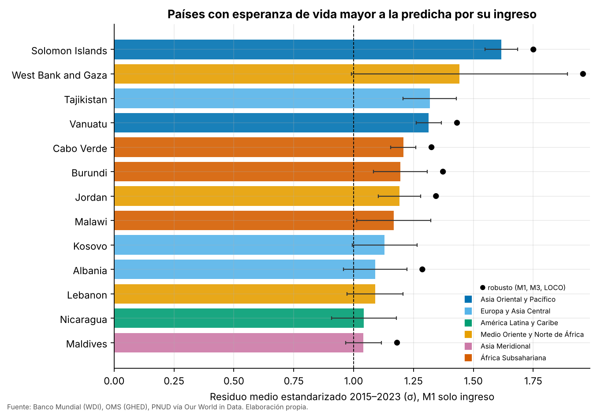
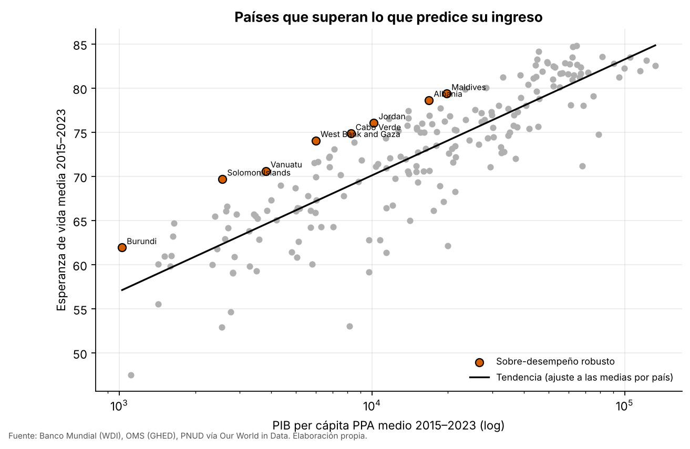
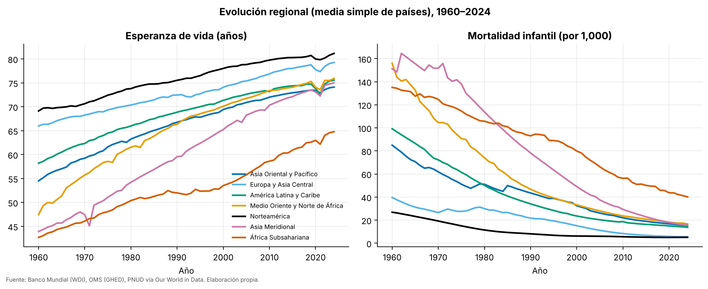
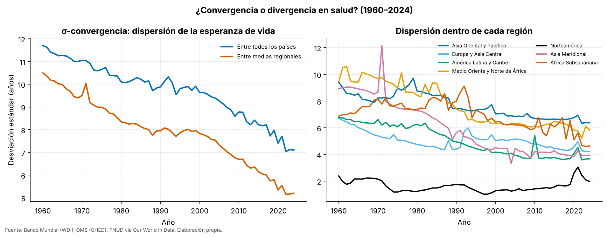
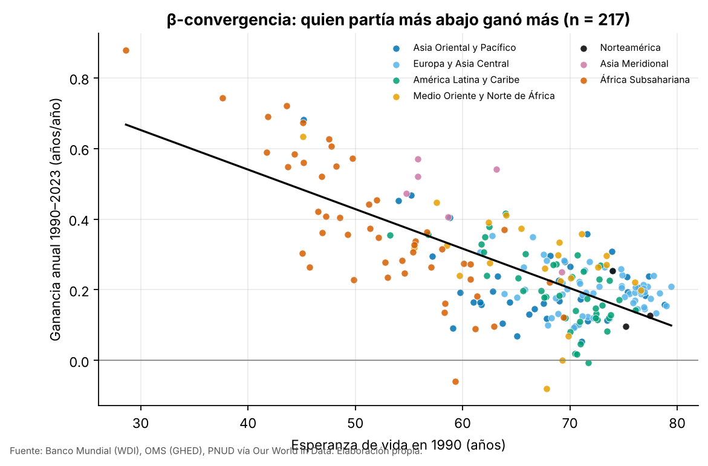

# Salud global y desarrollo humano
## Informe final de resultados — Equipo 4

**Materia:** Optativa III · Ciencia de Datos (Ingeniería en Computación, UNE Plantel Centro)
**Metodología:** CRISP-DM · **Periodo de análisis:** 2000–2023 (series completas 1960–2024)
**Fuentes:** Banco Mundial (WDI), OMS (GHED), PNUD vía Our World in Data

---

## 1. Resumen ejecutivo

Se integraron seis indicadores de 217 países en un panel reproducible y se estudió qué factores de desarrollo se asocian con la esperanza de vida. Los resultados son **asociaciones**, no efectos causales.

- **El ingreso importa, y con rendimientos decrecientes.** Con el logaritmo del PIB per cápita, el R² ajustado mejora de 0.46 (niveles) a 0.68. Duplicar el PIB per cápita se asocia con **+4.2 años** de esperanza de vida (IC 95 %: 3.9–4.6).
- **Gasto en salud y escolaridad aportan algo más, pero poco y de forma frágil.** En el modelo principal (M3) ambos son significativos, y R² ajustado sube de 0.680 a 0.718. Al controlar por región y año, la escolaridad pierde significancia; con efectos fijos de país solo el ingreso la conserva.
- **8 países superan de forma robusta lo que predice su ingreso** (2015–2023): Solomon Islands, West Bank and Gaza, Vanuatu, Cabo Verde, Burundi, Jordan, Albania, Maldives. Son economías pequeñas o de ingreso bajo y medio donde la esperanza de vida es de 1.0 a 1.6 desviaciones estándar por encima de lo esperado.
- **Las brechas se están cerrando.** La dispersión de la esperanza de vida entre países bajó de 9.9 años (1990) a 7.1 (2023); quien partía más abajo ganó más años por año (β = -0.0112, p < 0.001). La brecha entre la región más alta y la más baja bajó de 23.5 a 16.2 años.

## 2. Datos y método

### 2.1 Panel de análisis
El pipeline (`02_ingenieria/etl`) lee los archivos originales, verifica su integridad con SHA-256, pasa los indicadores a formato largo, excluye agregados regionales y mundiales y une por `(iso3, anio)` con la esperanza de vida como tabla base. El resultado es un panel de 217 países y 65 años (1960–2024), cargado a `warehouse/salud.db`.

| Variable | Fuente | Disponible desde |
|---|---|---|
| Esperanza de vida al nacer | Banco Mundial (UN WPP) | 1960 |
| Mortalidad infantil | Banco Mundial (UN IGME) | 1960 |
| PIB per cápita PPA (US$ constantes 2021) | Banco Mundial (ICP) | 1990 |
| Gasto corriente en salud (% PIB; per cápita PPA) | OMS – GHED | 2000 |
| Años promedio de escolaridad (adultos ≥ 25) | PNUD vía OWID | 1990 |

La variable limitante es el **gasto en salud** (desde 2000), por lo que los modelos usan **2000–2023**: 4,339 observaciones país-año de 186 países con las variables completas. En ese periodo, el 91 % de los datos de PIB y el 87 % de los de gasto en salud están presentes. Los datos faltantes no se imputaron: se trabajó con casos completos y se reporta la cobertura por región.



### 2.2 Modelos
Se ajustaron seis modelos de mínimos cuadrados con errores estándar **agrupados por país** (las observaciones de un mismo país no son independientes):

| Modelo | Especificación | R² ajustado | RMSE (años) | p RESET | p Breusch–Pagan |
|---|---|---|---|---|---|
| M0 | LE ~ PIB (niveles) | 0.465 | 6.28 | < 0.001 | 0.195 |
| M1 | LE ~ ln(PIB) | 0.680 | 4.86 | < 0.001 | < 0.001 |
| M2 | + ln(gasto salud pc) | 0.710 | 4.62 | 0.129 | < 0.001 |
| M3 | + escolaridad (modelo principal) | 0.718 | 4.56 | 0.103 | < 0.001 |
| M4 | M3 + efectos fijos de región y año | 0.802 | 3.80 | < 0.001 | < 0.001 |
| M5 | Panel: efectos fijos de país y año | 0.967 | 1.52 | < 0.001 | < 0.001 |

M3 es el modelo principal. Se evaluó además un modelo de gradient boosting (M6) solo como chequeo de no linealidades, y todos los modelos con validación temporal (entrenar hasta 2017, probar 2018–2023) y por países no vistos (5 pliegues).

## 3. Resultados

### 3.1 P1 — ¿Qué tan fuerte es la relación ingreso–esperanza de vida? ¿Es lineal?
La correlación de Spearman entre ln(PIB per cápita) y esperanza de vida es **0.86** (Pearson 0.82); con la mortalidad infantil es -0.79. **No es lineal en niveles: se aplana.** Un año extra de esperanza de vida "cuesta" mucho más ingreso en países ricos que en pobres. El logaritmo del ingreso explica más varianza que el ingreso en niveles en los 35 de 35 cortes transversales anuales; en 2021 el R² pasa de 0.56 a 0.71.



En la escala logarítmica la relación es aproximadamente lineal: **+10 % de PIB per cápita se asocia con +0.58 años** (M1). Además, la curva se desplaza hacia arriba con el tiempo: a igual ingreso, hoy se vive más que hace tres décadas (posiblemente por avances médicos y de salud pública, que estos datos no miden).



**Más allá del ingreso (M3).** Con gasto en salud y escolaridad en el modelo, el coeficiente del ingreso baja a 2.48: parte del efecto aparente del PIB opera a través de más gasto sanitario y más educación. Asociaciones estimadas en M3: +10 % de PIB, +0.24 años; +10 % de gasto en salud per cápita, +0.24 años; +1 año de escolaridad media, +0.38 años.

| Modelo | Variable | Coef. | Error est. (por país) | IC 95 % | p |
|---|---|---|---|---|---|
| M1 | ln PIB pc | 6.124 | 0.242 | [5.65; 6.60] | < 0.001 |
| M2 | ln PIB pc | 2.639 | 0.882 | [0.90; 4.38] | 0.003 |
| M2 | ln gasto salud pc | 3.130 | 0.733 | [1.68; 4.58] | < 0.001 |
| M3 | ln PIB pc | 2.476 | 0.863 | [0.77; 4.18] | 0.005 |
| M3 | ln gasto salud pc | 2.524 | 0.769 | [1.01; 4.04] | 0.001 |
| M3 | Escolaridad (años) | 0.384 | 0.143 | [0.10; 0.67] | 0.008 |
| M4 | ln PIB pc | 2.339 | 0.817 | [0.73; 3.95] | 0.005 |
| M4 | ln gasto salud pc | 1.817 | 0.773 | [0.29; 3.34] | 0.020 |
| M4 | Escolaridad (años) | 0.039 | 0.137 | [-0.23; 0.31] | 0.778 |
| M5 | ln PIB pc | 2.114 | 0.735 | [0.66; 3.56] | 0.004 |
| M5 | ln gasto salud pc | -0.355 | 0.436 | [-1.22; 0.51] | 0.417 |
| M5 | Escolaridad (años) | 0.135 | 0.203 | [-0.27; 0.53] | 0.506 |



**Lectura prudente.** El efecto de la escolaridad y del gasto es sensible a la especificación: con efectos fijos de región y año (M4) la escolaridad deja de ser significativa (p = 0.778); con efectos fijos de país (M5) solo el ingreso sigue siendo significativo. Esto indica que buena parte de la asociación proviene de **diferencias entre países**, no de cambios dentro de cada país.

**Diagnósticos de M3.** VIF de ln PIB = 8.2 y de ln gasto = 9.5: hay colinealidad alta pero por debajo de 10, lo que explica la inestabilidad de los coeficientes individuales. Hay heterocedasticidad (Breusch–Pagan p < 0.001) y residuos no normales (Jarque–Bera p < 0.001), por lo que se usan errores agrupados por país. RESET no rechaza M3 (p = 0.10), pero sí rechaza M0 y M1, así que la forma funcional lineal en niveles es inadecuada.



**Capacidad predictiva.**

| Modelo | Esquema | MAE | RMSE | R² |
|---|---|---|---|---|
| M0 | temporal | 4.35 | 5.41 | 0.47 |
| M0 | países no vistos | 4.92 | 6.33 | 0.456 |
| M1 | temporal | 3.42 | 4.27 | 0.671 |
| M1 | países no vistos | 3.58 | 4.91 | 0.673 |
| M2 | temporal | 3.04 | 4.0 | 0.71 |
| M2 | países no vistos | 3.35 | 4.7 | 0.701 |
| M3 | temporal | 3.14 | 4.09 | 0.698 |
| M3 | países no vistos | 3.38 | 4.67 | 0.704 |
| M3+región | temporal | 3.06 | 4.01 | 0.71 |
| M3+región | países no vistos | 3.03 | 4.14 | 0.767 |
| M6 GBM | temporal | 2.82 | 3.87 | 0.729 |
| M6 GBM | países no vistos | 3.09 | 4.39 | 0.738 |

El modelo de ingreso solo (M1) ya logra R² ≈ 0.67 fuera de muestra. Agregar gasto en salud mejora el error (M2); agregar escolaridad **no mejora la predicción temporal**. El gradient boosting (M6) reduce el error más que cualquier modelo lineal, lo que sugiere heterogeneidad regional y no linealidades que el modelo lineal no captura; en M6 la variable más importante es el gasto en salud per cápita (la importancia se reparte entre variables correlacionadas, por lo que no equivale a causalidad).

### 3.2 P2 — ¿Qué países logran alta esperanza de vida con bajo ingreso?
Se estimó la esperanza de vida esperada dado el ingreso (M1 con efectos fijos de año, 1990–2023, para separar el desplazamiento global de la curva) y se calculó el residuo estandarizado de cada país en 2015–2023. **Criterio:** residuo medio ≥ +1 σ **y** residuo positivo en ≥ 70 % de los años. Un país es **robusto** si además cumple el criterio con (a) M3 con efectos de año, que descuenta gasto y educación, y (b) validación dejando fuera al propio país.

De 13 candidatos bajo M1, 8 siguen cumpliendo bajo M3 y 8 sobreviven a todas las pruebas:

| País | Región | Esp. vida 2015–23 | PIB pc PPA (US$) | Gasto salud pc (US$) | Escolaridad | z medio M1 | % años > 0 |
|---|---|---|---|---|---|---|---|
| Solomon Islands | Asia Oriental y Pacífico | 69.7 | 2,563 | 117 | 5.8 | 1.62 | 100 |
| West Bank and Gaza | Medio Oriente y Norte de África | 74.1 | 5,998 | 554 | 9.7 | 1.44 | 89 |
| Vanuatu | Asia Oriental y Pacífico | 70.6 | 3,805 | 121 | 7.0 | 1.31 | 100 |
| Cabo Verde | África Subsahariana | 74.8 | 8,255 | 448 | 6.0 | 1.21 | 100 |
| Burundi | África Subsahariana | 61.9 | 1,027 | 69 | 3.0 | 1.2 | 100 |
| Jordan | Medio Oriente y Norte de África | 76.1 | 10,182 | 692 | 10.4 | 1.19 | 100 |
| Albania | Europa y Asia Central | 78.6 | 16,819 | 1046 | 10.1 | 1.09 | 100 |
| Maldives | Asia Meridional | 79.4 | 19,792 | 1760 | 7.0 | 1.04 | 100 |





**Qué podemos aprender (con cautela).** Los casos robustos son en su mayoría economías pequeñas, con gasto en salud per cápita entre US$ 69 y 1,760 y escolaridad media entre 3.0 y 10.4 años: no se explican por un gasto alto. Burundi destaca por alcanzar ~62 años con el PIB per cápita más bajo de la lista. Los datos de este proyecto **no permiten identificar las causas**; explorar sistemas de atención primaria, vacunación o programas comunitarios requeriría fuentes adicionales (p. ej., indicadores de la OMS-GHO). 5 países cumplen el criterio bajo M1 pero no bajo M3 (Tajikistan, Malawi, Kosovo, Lebanon, Nicaragua): su ventaja no resiste el control por gasto en salud y escolaridad.

**Los casos opuestos** (esperanza de vida muy inferior a la que predice su ingreso) incluyen economías de ingreso medio con alta carga de enfermedad, economías basadas en recursos naturales y países muy pequeños; estos datos no permiten contrastar esas explicaciones:

| País | Región | z medio | Residuo medio (años) |
|---|---|---|---|
| Nigeria | África Subsahariana | -3.1 | -15.7 |
| Equatorial Guinea | África Subsahariana | -2.37 | -12.0 |
| Eswatini | África Subsahariana | -2.1 | -10.6 |
| Greenland | Europa y Asia Central | -2.09 | -10.6 |
| Naoero | Asia Oriental y Pacífico | -1.85 | -9.3 |
| Central African Republic | África Subsahariana | -1.74 | -8.8 |

> **Advertencia.** Los países pequeños (Islas Salomón, Vanuatu, Maldivas, Cabo Verde) tienen estimaciones más ruidosas de la esperanza de vida y del PIB per cápita. Los intervalos de la figura reflejan solo la variación entre años (n = 9), no la incertidumbre de medición de las fuentes.

### 3.3 P3 — ¿Cómo ha evolucionado la desigualdad en salud entre regiones?
La esperanza de vida mejoró en todas las regiones, y las brechas se redujeron. La desviación estándar entre países pasó de 11.7 años en 1960 a 9.9 en 1990 y 7.1 en 2023 (**σ-convergencia**). En la regresión de **β-convergencia** 1990–2023, el coeficiente es -0.0112 (p < 0.001, R² = 0.53, n = 217): cada año adicional de esperanza de vida inicial se asocia con 0.011 años menos de ganancia anual.

| Año | Asia Oriental y Pacífico | Europa y Asia Central | América Latina y Caribe | Medio Oriente y Norte de África | Norteamérica | Asia Meridional | África Subsahariana |
|---|---|---|---|---|---|---|---|
| 1960 | 54.5 | 65.99 | 58.2 | 47.48 | 69.13 | 43.91 | 42.67 |
| 1990 | 66.76 | 72.47 | 68.86 | 66.33 | 75.53 | 59.57 | 51.99 |
| 2000 | 69.43 | 74.07 | 71.35 | 70.1 | 78.02 | 65.23 | 53.51 |
| 2010 | 72.0 | 76.87 | 73.17 | 73.38 | 79.76 | 70.32 | 58.62 |
| 2019 | 73.47 | 78.79 | 74.75 | 75.3 | 80.73 | 73.51 | 62.58 |
| 2023 | 73.96 | 79.05 | 75.38 | 75.48 | 80.77 | 74.75 | 64.56 |





**Matices.** La convergencia no fue uniforme: África Subsahariana avanzó poco entre 1990 y 2000 (de 52 a 54 años, periodo coincidente con la epidemia de VIH/SIDA) y aún es la región más rezagada (≈ 65 años en 2023 frente a ≈ 81 en Norteamérica). El análisis usa medias simples de países, sin ponderar por población.



## 4. Evaluación de hipótesis

| ID | Hipótesis | Veredicto | Evidencia |
|---|---|---|---|
| H1 | La relación esperanza de vida–PIB es cóncava (ln supera a niveles) | Respaldada | R² aj. M0=0.465 vs M1=0.680; RESET M0 p=4.3e-268 |
| H2 | Gasto en salud y escolaridad aportan más allá del ingreso | Parcialmente respaldada | M3 (agrupado): p(ln gasto)=0.0012, p(escolaridad)=0.0078; con efectos fijos M4: p=0.02/0.78; M5: p=0.42/0.51 |
| H3 | Existen países de sobre-desempeño robustos | Respaldada | 13 bajo M1; 8 también bajo M3; 8 robustos (también leave-one-country-out) |
| H4 | La brecha de esperanza de vida converge (1990–2023) | Respaldada | σ 1990=9.88 → 2023=7.12; β=-0.0112 (p=5.5e-28) |

## 5. Limitaciones

- **Diseño observacional:** los resultados son asociaciones. Los efectos fijos de país (M5) muestran que lo que se observa entre países no se replica automáticamente dentro de un mismo país a lo largo del tiempo.
- **Cobertura:** el gasto en salud solo existe desde 2000 y su disponibilidad es desigual por región; la cobertura es menor en Norteamérica (67 %), Asia Oriental y Pacífico (78 %) y América Latina y el Caribe (77 %), por lo que los resultados pueden no representar a esos países (sesgo de selección posible). No se imputaron faltantes.
- **Colinealidad** entre PIB y gasto en salud (VIF ≈ 8–9) dificulta separar sus efectos.
- **Unidades:** el PIB está en dólares constantes de 2021 y el gasto per cápita en dólares corrientes; no se combinaron en razones.
- **Medición:** la esperanza de vida de varios países es una estimación modelada (UN WPP) y presenta anomalías puntuales. La regla de calidad del ETL (20–95 años) excluye 9 país-año, algunos de los cuales son crisis reales (Camboya 1975–78, Ruanda 1994) y otros posibles errores de la fuente (República Centroafricana 2009 y 2022, Sudán del Sur 1988 y 1998); esto afecta marginalmente las series históricas. La escolaridad no mide calidad educativa.
- **Ponderación:** las medias regionales son simples, no ponderadas por población.
- **Umbral de sobre-desempeño:** el criterio (+1 σ, 70 % de años) es una convención del equipo; otros umbrales cambiarían la lista.

## 6. Conclusiones y recomendaciones

1. El ingreso es el predictor individual más fuerte de la esperanza de vida, con rendimientos decrecientes; para un país pobre, un mismo aumento proporcional de ingreso se asocia con ganancias de salud mucho mayores que para uno rico.
2. Gasto en salud y educación se asocian con mayor esperanza de vida, pero su aporte independiente es modesto y no resiste todos los controles; no deben presentarse como "efectos".
3. Hay países que logran más salud de la que su ingreso predice; **estudiarlos con datos adicionales** (cobertura de salud primaria, vacunación) es el siguiente paso natural.
4. La salud global converge: las brechas entre países y regiones se redujeron de forma sostenida desde 1960, aunque África Subsahariana sigue muy rezagada.
5. **Trabajo futuro:** incorporar población (ponderación), indicadores de la OMS-GHO, modelos de panel dinámico y análisis por grupos de ingreso.

## 7. Reproducibilidad

```bash
make install   # dependencias
make all       # ETL, pruebas, análisis, modelos e informe
```

Cada cifra de este informe se regenera desde los datos originales (verificados con SHA-256). Código: `02_ingenieria/etl`, `04_analisis/scripts`, `05_ciencia/scripts`, `common/`. Resultados: `04_analisis/tablas`, `05_ciencia/resultados`.

## Anexo — Fuentes citadas

- Banco Mundial, World Development Indicators (SP.DYN.LE00.IN, SP.DYN.IMRT.IN, NY.GDP.PCAP.PP.KD).
- Organización Mundial de la Salud, Global Health Expenditure Database (SH.XPD.CHEX.GD.ZS, SH.XPD.CHEX.PP.CD), actualización de diciembre de 2025.
- PNUD, Human Development Report 2025, vía Our World in Data (años promedio de escolaridad).
- UN World Population Prospects; UN Inter-agency Group for Child Mortality Estimation.
